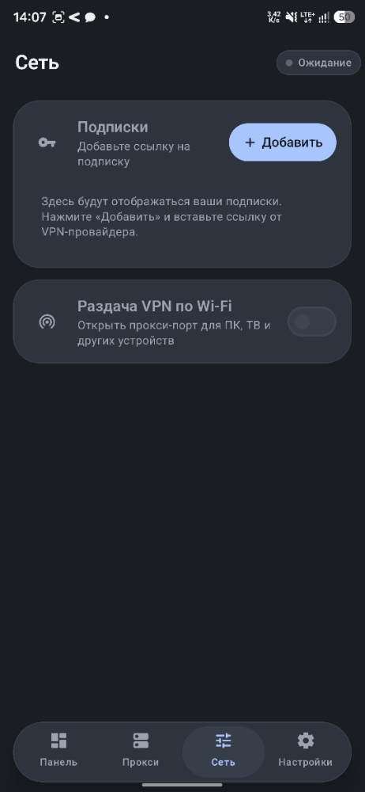

<div align="center">


# KestrelTun

**Open-source native Android VPN & proxy client built on Mihomo (Clash.Meta) and Full TUN.**

[](README.md) [](README_RU.md)

[](https://github.com/Meowt3/KestrelTun/releases/latest)
[](https://github.com/Meowt3/KestrelTun/releases)
[](https://github.com/Meowt3/KestrelTun/actions/workflows/build-apk.yml)
[](https://github.com/Meowt3/KestrelTun/releases/latest)
[](https://github.com/MetaCubeX/mihomo)
[](LICENSE)

[Download](#download) · [Features](#features) · [Supported Protocols](#supported-protocols) · [Architecture](#architecture) · [Build from Source](#build-from-source)

</div>

> **Русский:** Открытый нативный Android VPN-клиент на ядре **Mihomo (Clash.Meta)** и **hev-socks5-tunnel (Full TUN)**. Поддержка **VLESS Reality**, **Hysteria2**, **TUIC**, **WireGuard**, **Trojan**, **VMess** и **Shadowsocks**, **автотуннелинг** с быстрым пакетным пингом, умное разделение трафика (Split Tunneling) и встроенный AdBlock. Подробное описание на русском — в [README_RU.md](README_RU.md).

---

## Overview

**KestrelTun** is a lightweight, ad-free, open-source native Android VPN & proxy fork based on **[FlClash](https://github.com/chen08209/FlClash)** and **[FlClashX](https://github.com/pluralplay/FlClashX)**, rewritten natively in **Kotlin** and **Jetpack Compose**. It combines the **Mihomo (Clash.Meta)** routing engine with a native C **hev-socks5-tunnel** Full TUN bridge for stable, low-overhead tunneling over both Wi-Fi and mobile networks.

## Screenshots

| Dashboard | Network & Subscriptions | Settings & Themes |
| :---: | :---: | :---: |
|  |  |  |

## Download

Get the latest signed Release APK from [GitHub Releases](https://github.com/Meowt3/KestrelTun/releases/latest):

| Architecture | Package | Best For |
| --- | --- | --- |
| **Universal** | [`KestrelTun-v1.2.0-universal-release.apk`](https://github.com/Meowt3/KestrelTun/releases/latest/download/KestrelTun-v1.2.0-universal-release.apk) | Any Android 10+ device (if unsure) |
| **`arm64-v8a`** | [`KestrelTun-v1.2.0-arm64-v8a-release.apk`](https://github.com/Meowt3/KestrelTun/releases/latest/download/KestrelTun-v1.2.0-arm64-v8a-release.apk) | Modern 64-bit phones (recommended, smaller size) |
| **`armeabi-v7a`** | [`KestrelTun-v1.2.0-armeabi-v7a-release.apk`](https://github.com/Meowt3/KestrelTun/releases/latest/download/KestrelTun-v1.2.0-armeabi-v7a-release.apk) | Older 32-bit Android phones & Android TV boxes |
| **`x86_64`** | [`KestrelTun-v1.2.0-x86_64-release.apk`](https://github.com/Meowt3/KestrelTun/releases/latest/download/KestrelTun-v1.2.0-x86_64-release.apk) | Emulators, Chromebooks, WSA & x86_64 tablets |

### Quick Start

1. Download and install the latest APK from [Releases](https://github.com/Meowt3/KestrelTun/releases/latest).
2. Open **Network → Subscriptions** and paste your Clash YAML or proxy subscription link (or import individual share links).
3. Select a server or enable **Auto-Tunneling** on the **Proxies** tab, then tap **Connect** on the **Dashboard**.

## Features

- **Auto-Tunneling**: Built-in **Auto** mode and custom auto-tunneling groups powered by native Go batch latency checks (`/group/{name}/delay`, `unified-delay`). Automatically switches to the lowest-latency server on startup, on a configurable timer, or on manual refresh.
- **Full TUN Networking**: Native `mihomo` + `hev-socks5-tunnel` TUN stack with IPv4/IPv6 capture, `mapdns`, proxy-routed DoH, and automatic connection reset when switching between Wi-Fi and mobile data.
- **Smart Split Tunneling**: One-tap regional app bypass (banking, government, and local marketplace apps) alongside full manual per-app include/exclude lists.
- **Rule-Based Routing & AdBlock**: Built-in AdBlock (`category-ads-all.mrs`), regional bypass rules (`category-ru.mrs` + `geoip/ru.mrs`), dedicated AI/Gemini routing with QUIC fallback, and custom Always-VPN / Always-Direct domain lists.
- **Subscription Management**: Automatic subscription refresh on app launch, manual sync, traffic quota and expiration bar (`Subscription-Userinfo`), and support for both Clash YAML and URI-based subscriptions.
- **Native Material You Interface**: Clean Bento-style dashboard with Light, Dark, and AMOLED themes, real-time speed graph, live connections inspector, YAML config preview, and core log export.
- **Battery-Friendly Operation**: R8-optimized release binary, lifecycle-aware UI updates, and eco mode that pauses background auto-tunneling checks while the screen is off.

## Supported Protocols

| Category | Protocols & Transports |
| --- | --- |
| **Modern Proxies** | `VLESS` (Reality, TLS, XTLS-Vision, WS, gRPC, HTTPUpgrade, h2), `Hysteria` / `Hysteria2`, `TUIC` |
| **Classic & VPN** | `WireGuard`, `Trojan`, `VMess`, `Shadowsocks` / `SSR`, `SOCKS5`, `HTTP` |
| **Subscriptions** | Clash / Mihomo YAML, Base64 link lists, plain URI share links |

## Architecture

| Component | Implementation |
| --- | --- |
| **Proxy Core** | [Mihomo (Clash.Meta)](https://github.com/MetaCubeX/mihomo) `v1.19.34` (`libmihomo.so`, Go) |
| **TUN Bridge** | [hev-socks5-tunnel](https://github.com/heiher/hev-socks5-tunnel) `v2.20.0` (`libhev-socks5-tunnel.so`, C) |
| **Application UI** | Native Android — Kotlin, Jetpack Compose, Material 3 |
| **Target Platform** | Android 10–15+ (`minSdk 29`, `targetSdk 35`, `arm64-v8a` / `armeabi-v7a` / `x86_64` / `universal`) |

## Build from Source

Every push to `main` automatically builds and publishes a signed Release APK via [GitHub Actions](.github/workflows/build-apk.yml).

To build locally (requires **JDK 17**, **Android SDK 35**, and **Gradle 8.9**):

```bash
git clone https://github.com/Meowt3/KestrelTun.git
cd KestrelTun

mkdir -p app/src/main/jniLibs/arm64-v8a
curl -fsSL https://github.com/MetaCubeX/mihomo/releases/download/v1.19.34/mihomo-android-arm64-v8-v1.19.34.gz \
  | gunzip > app/src/main/jniLibs/arm64-v8a/libmihomo.so

gradle assembleRelease
```

## Acknowledgments

- [MetaCubeX/mihomo](https://github.com/MetaCubeX/mihomo) — rule-based proxy core
- [heiher/hev-socks5-tunnel](https://github.com/heiher/hev-socks5-tunnel) — native C TUN-to-SOCKS5 tunnel
- [chen08209/FlClash](https://github.com/chen08209/FlClash) & [pluralplay/FlClashX](https://github.com/pluralplay/FlClashX) — base client architecture, Bento UI/UX philosophy, QuickAction toggle, and concurrent latency-testing concepts

## License

KestrelTun is free and open-source software licensed under the [GNU General Public License v3.0](LICENSE).
