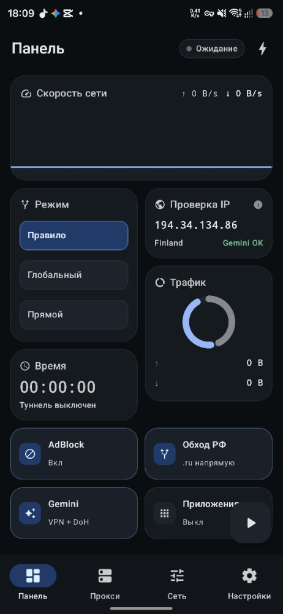
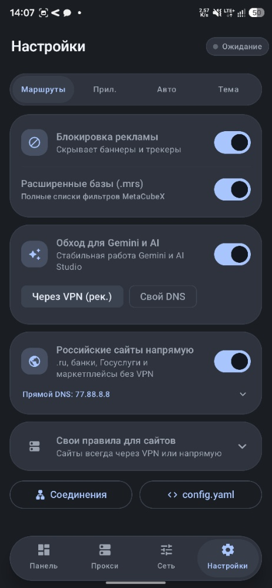

<div align="center">


# KestrelTun

**Open-source native Android proxy & rule-based network client built on Mihomo (Clash.Meta) and Full TUN.**

[](README.md) [](README_RU.md)

[](https://github.com/Meowt3/KestrelTun/releases/latest)
[](https://github.com/Meowt3/KestrelTun/releases)
[](https://github.com/Meowt3/KestrelTun/actions/workflows/build-apk.yml)
[](https://github.com/Meowt3/KestrelTun/releases/latest)
[](https://github.com/MetaCubeX/mihomo)
[](LICENSE)

[Download](#download) · [Features](#features) · [Supported Protocols](#supported-protocols) · [Architecture](#architecture) · [Build from Source](#build-from-source) · [Disclaimer](#disclaimer)

</div>

> **Русский:** Открытый нативный Android-клиент для маршрутизации трафика и работы с собственными прокси-серверами на ядре **Mihomo (Clash.Meta)** и **hev-socks5-tunnel (Full TUN)**. Поддержка **VLESS Reality**, **Hysteria2**, **TUIC**, **WireGuard**, **Trojan**, **VMess** и **Shadowsocks**, **автотуннелинг**, разделение трафика по приложениям и фильтрация рекламы. Подробное описание — в [README_RU.md](README_RU.md).

---

## Overview

**KestrelTun** is a lightweight, ad-free, open-source native Android network and proxy client written from scratch in **Kotlin** and **Jetpack Compose**, inspired by the interface and concepts of **[FlClash](https://github.com/chen08209/FlClash)** and **[FlClashX](https://github.com/pluralplay/FlClashX)**. It combines the **Mihomo (Clash.Meta)** routing engine with a native C **hev-socks5-tunnel** Full TUN bridge for stable, low-overhead tunneling over Wi-Fi and mobile networks.

## Screenshots

| Dashboard | Network & Subscriptions | Settings & Themes |
| :---: | :---: | :---: |
|  |  |  |

## Download

Get the latest signed Release APK from [GitHub Releases](https://github.com/Meowt3/KestrelTun/releases/latest):

| Architecture | Package | Best For |
| --- | --- | --- |
| **Universal** | [`KestrelTun-v1.2.0-universal-release.apk`](https://github.com/Meowt3/KestrelTun/releases/latest/download/KestrelTun-v1.2.0-universal-release.apk) | Any Android 10+ device (if unsure) |
| **`arm64-v8a`** | [`KestrelTun-v1.2.0-arm64-v8a-release.apk`](https://github.com/Meowt3/KestrelTun/releases/latest/download/KestrelTun-v1.2.0-arm64-v8a-release.apk) | Modern 64-bit phones (recommended, smaller size) |
| **`armeabi-v7a`** | [`KestrelTun-v1.2.0-armeabi-v7a-release.apk`](https://github.com/Meowt3/KestrelTun/releases/latest/download/KestrelTun-v1.2.0-armeabi-v7a-release.apk) | Older 32-bit Android phones & Android TV boxes |
| **`x86_64`** | [`KestrelTun-v1.2.0-x86_64-release.apk`](https://github.com/Meowt3/KestrelTun/releases/latest/download/KestrelTun-v1.2.0-x86_64-release.apk) | Emulators, Chromebooks, WSA & x86_64 tablets |

### Quick Start

1. Download and install the latest APK from [Releases](https://github.com/Meowt3/KestrelTun/releases/latest).
2. Open **Network → Subscriptions** and add your own Clash YAML or proxy subscription URL.
3. Select a node or enable **Auto-Tunneling** on the **Proxies** tab, then tap **Connect** on the **Dashboard**.

## Features

- **Auto-Tunneling**: Built-in **Auto** mode and custom auto-tunneling groups with 64-slot concurrent latency checks, smart priority queue (previously responsive nodes tested first), and automatic switching to the lowest-latency server.
- **Full TUN Networking**: Native `mihomo` + `hev-socks5-tunnel` TUN stack with IPv4/IPv6 capture, `mapdns`, encrypted DoH resolution, and automatic connection reset on Wi-Fi ↔ mobile handoff.
- **Per-App Split Tunneling**: Flexible per-app include/exclude routing lists with one-tap local-app selection.
- **Rule-Based Routing & AdBlock**: Built-in ad/tracker filtering (`category-ads-all.mrs`), direct routing for local domains (`DIRECT`), encrypted DoH routing rules, and custom domain rule lists.
- **Subscription Management**: Automatic profile refresh on startup, manual sync, traffic quota and expiration bar (`Subscription-Userinfo`), and local Wi-Fi proxy sharing (Allow LAN).
- **Material 3 Expressive Interface**: Soft neutral-gray dark theme, pure-black **AMOLED** mode, Light mode, 9 pastel accent palettes, floating pill navigation, smooth spring animations, live connections inspector, YAML preview, and core log export.
- **Background Quick Toggle**: Supports Android App Shortcuts and silent background toggle actions without minimizing the active foreground app.

## Supported Protocols

| Category | Protocols & Transports |
| --- | --- |
| **Modern Proxies** | `VLESS` (Reality, TLS, XTLS-Vision, WS, gRPC, HTTPUpgrade, h2), `Hysteria` / `Hysteria2`, `TUIC` |
| **Classic & Tunnel** | `WireGuard`, `Trojan`, `VMess`, `Shadowsocks` / `SSR`, `SOCKS5`, `HTTP` |
| **Subscriptions** | Clash / Mihomo YAML, Base64 link lists, plain URI share links |

## Architecture

| Component | Implementation |
| --- | --- |
| **Proxy Core** | [Mihomo (Clash.Meta)](https://github.com/MetaCubeX/mihomo) `v1.19.34` (`libmihomo.so`, Go) |
| **TUN Bridge** | [hev-socks5-tunnel](https://github.com/heiher/hev-socks5-tunnel) `v2.20.0` (`libhev-socks5-tunnel.so`, C) |
| **Application UI** | Native Android — Kotlin, Jetpack Compose, Material 3 |
| **Target Platform** | Android 10–15+ (`minSdk 29`, `targetSdk 35`, `arm64-v8a` / `armeabi-v7a` / `x86_64` / `universal`) |

## Build from Source

Every push to `main` automatically runs unit tests and builds signed Release APKs via [GitHub Actions](.github/workflows/build-apk.yml).

To build locally (requires **JDK 17**, **Android SDK 35**, and **Gradle 8.9**):

```bash
git clone https://github.com/Meowt3/KestrelTun.git
cd KestrelTun

mkdir -p app/src/main/jniLibs/arm64-v8a
curl -fsSL https://github.com/MetaCubeX/mihomo/releases/download/v1.19.34/mihomo-android-arm64-v8-v1.19.34.gz \
  | gunzip > app/src/main/jniLibs/arm64-v8a/libmihomo.so

gradle assembleRelease
```

## Disclaimer & Privacy

- **Client Software Only**: KestrelTun is an independent, open-source networking client intended for managing user-owned proxy servers, testing network routing, and protecting traffic on untrusted networks. It does **not** bundle, sell, or provide any VPN servers or subscription services.
- **User Responsibility**: Users are solely responsible for the configurations they import and for complying with all applicable laws and regulations in their jurisdiction.
- **Privacy**: KestrelTun contains no analytics, telemetry, or ads; all settings and profiles stay locally on your device. See [PRIVACY.md](PRIVACY.md).
- **Trademarks**: All third-party names and trademarks belong to their respective owners. KestrelTun is not affiliated with or endorsed by any third-party brand.

## Acknowledgments & Third-Party Licenses

- [MetaCubeX/mihomo](https://github.com/MetaCubeX/mihomo) (`GPL-3.0`) — rule-based proxy core
- [heiher/hev-socks5-tunnel](https://github.com/heiher/hev-socks5-tunnel) (`MIT`) — native C TUN-to-SOCKS5 tunnel
- [chen08209/FlClash](https://github.com/chen08209/FlClash) & [pluralplay/FlClashX](https://github.com/pluralplay/FlClashX) (`GPL-3.0`) — UI/UX design inspiration, Bento layout philosophy, background quick action pattern, and concurrent latency-testing concepts

Full third-party license attributions are listed in [NOTICE](NOTICE).

## License

KestrelTun is free and open-source software licensed under the [GNU General Public License v3.0](LICENSE).
