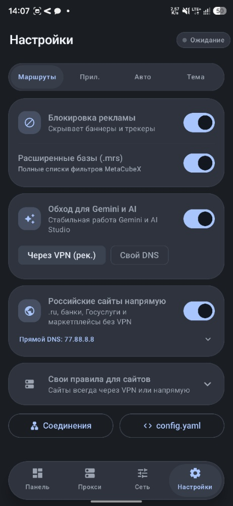

<div align="center">


# KestrelTun

**Открытый нативный Android VPN- и прокси-клиент на ядре Mihomo (Clash.Meta) с Full TUN.**

[](README.md) [](README_RU.md)

[](https://github.com/Meowt3/KestrelTun/releases/latest)
[](https://github.com/Meowt3/KestrelTun/releases)
[](https://github.com/Meowt3/KestrelTun/actions/workflows/build-apk.yml)
[](https://github.com/Meowt3/KestrelTun/releases/latest)
[](https://github.com/MetaCubeX/mihomo)
[](LICENSE)

[Скачать](#скачать) · [Возможности](#возможности) · [Протоколы](#поддерживаемые-протоколы) · [Архитектура](#архитектура) · [Сборка из исходников](#сборка-из-исходников)

</div>

---

## О проекте

**KestrelTun** — лёгкий открытый нативный Android-форк на основе **[FlClash](https://github.com/chen08209/FlClash)** и **[FlClashX](https://github.com/pluralplay/FlClashX)** без рекламы и телеметрии, написанный на **Kotlin** и **Jetpack Compose**. Приложение объединяет движок маршрутизации **Mihomo (Clash.Meta)** и нативный C-мост **hev-socks5-tunnel (Full TUN)** для стабильной работы по Wi-Fi и мобильной сети.

## Скриншоты

| Панель | Сеть и подписки | Настройки и темы |
| :---: | :---: | :---: |
|  |  |  |

## Скачать

Последнюю подписанную Release-сборку APK можно скачать на странице [GitHub Releases](https://github.com/Meowt3/KestrelTun/releases/latest):

| Архитектура | Файл | Для каких устройств |
| --- | --- | --- |
| **Universal** | [`KestrelTun-v1.2.0-universal-release.apk`](https://github.com/Meowt3/KestrelTun/releases/latest/download/KestrelTun-v1.2.0-universal-release.apk) | Любой Android 10+ (если не знаете архитектуру) |
| **`arm64-v8a`** | [`KestrelTun-v1.2.0-arm64-v8a-release.apk`](https://github.com/Meowt3/KestrelTun/releases/latest/download/KestrelTun-v1.2.0-arm64-v8a-release.apk) | Современные 64-битные смартфоны (рекомендуется) |
| **`armeabi-v7a`** | [`KestrelTun-v1.2.0-armeabi-v7a-release.apk`](https://github.com/Meowt3/KestrelTun/releases/latest/download/KestrelTun-v1.2.0-armeabi-v7a-release.apk) | Старые 32-битные смартфоны и Android TV-приставки |
| **`x86_64`** | [`KestrelTun-v1.2.0-x86_64-release.apk`](https://github.com/Meowt3/KestrelTun/releases/latest/download/KestrelTun-v1.2.0-x86_64-release.apk) | Эмуляторы, Chromebook, WSA и x86_64 планшеты |

### Быстрый старт

1. Скачайте и установите актуальный APK из раздела [Releases](https://github.com/Meowt3/KestrelTun/releases/latest).
2. Перейдите в **Сеть → Подписки** и добавьте ссылку на подписку (Clash YAML или список серверов).
3. Выберите нужный сервер или включите **Автотуннелинг** на вкладке **Прокси**, затем нажмите **Подключиться** на главной панели.

## Возможности

- **Автотуннелинг**: Встроенный режим **Авто** и пользовательские группы автотуннелинга на базе быстрого пакетного пинга Go (`/group/{name}/delay`, `unified-delay`). Автоматически выбирает и переключается на самый быстрый сервер при старте, по настраиваемому таймеру или при ручном обновлении.
- **Полноценный Full TUN**: Связка `mihomo` + `hev-socks5-tunnel` с перехватом IPv4/IPv6, `mapdns`, маршрутизацией DoH через прокси и автоматическим сбросом зависших соединений при переключении Wi-Fi ↔ мобильная сеть.
- **Умное разделение трафика (Split Tunneling)**: Выбор локальных приложений в одно нажатие (банки, госсервисы, маркетплейсы) плюс гибкие ручные списки исключений и включений по приложениям.
- **Маршрутизация по правилам и AdBlock**: Встроенный блокировщик рекламы (`category-ads-all.mrs`), обход локальных сайтов (`category-ru.mrs` + `geoip/ru.mrs`), выделенные правила для AI/Gemini с откатом QUIC и пользовательские списки доменов («Всегда через VPN» / «Всегда напрямую»).
- **Управление подписками**: Автообновление подписки при запуске, ручная синхронизация, отображение остатка трафика и срока действия (`Subscription-Userinfo`), поддержка Clash YAML и URI-ссылок.
- **Нативный интерфейс Material You**: Чистая Bento-панель со светлой, тёмной и AMOLED-темами, графиком скорости в реальном времени, просмотром активных соединений, предпросмотром YAML-конфига и экспортом логов ядра.
- **Экономия заряда**: Оптимизированная R8-сборка, остановка фоновых обновлений при свёрнутом приложении и эко-режим с паузой проверок автотуннелинга при выключенном экране.

## Поддерживаемые протоколы

| Категория | Протоколы и транспорты |
| --- | --- |
| **Современные протоколы** | `VLESS` (Reality, TLS, XTLS-Vision, WS, gRPC, HTTPUpgrade, h2), `Hysteria` / `Hysteria2`, `TUIC` |
| **Классические и VPN** | `WireGuard`, `Trojan`, `VMess`, `Shadowsocks` / `SSR`, `SOCKS5`, `HTTP` |
| **Форматы подписок** | Clash / Mihomo YAML, списки Base64, прямые URI-ссылки |

## Архитектура

| Компонент | Реализация |
| --- | --- |
| **Ядро прокси** | [Mihomo (Clash.Meta)](https://github.com/MetaCubeX/mihomo) `v1.19.34` (`libmihomo.so`, Go) |
| **TUN-мост** | [hev-socks5-tunnel](https://github.com/heiher/hev-socks5-tunnel) `v2.20.0` (`libhev-socks5-tunnel.so`, C) |
| **Интерфейс** | Нативный Android — Kotlin, Jetpack Compose, Material 3 |
| **Целевая платформа** | Android 10–15+ (`minSdk 29`, `targetSdk 35`, `arm64-v8a` / `armeabi-v7a` / `x86_64` / `universal`) |

## Сборка из исходников

Каждый коммит в ветку `main` автоматически собирает и публикует подписанный Release APK через [GitHub Actions](.github/workflows/build-apk.yml).

Для локальной сборки (требуются **JDK 17**, **Android SDK 35** и **Gradle 8.9**):

```bash
git clone https://github.com/Meowt3/KestrelTun.git
cd KestrelTun

mkdir -p app/src/main/jniLibs/arm64-v8a
curl -fsSL https://github.com/MetaCubeX/mihomo/releases/download/v1.19.34/mihomo-android-arm64-v8-v1.19.34.gz \
  | gunzip > app/src/main/jniLibs/arm64-v8a/libmihomo.so

gradle assembleRelease
```

## Благодарности

- [MetaCubeX/mihomo](https://github.com/MetaCubeX/mihomo) — ядро маршрутизации прокси
- [heiher/hev-socks5-tunnel](https://github.com/heiher/hev-socks5-tunnel) — нативный C-туннель TUN-to-SOCKS5
- [chen08209/FlClash](https://github.com/chen08209/FlClash) и [pluralplay/FlClashX](https://github.com/pluralplay/FlClashX) — основа форка, концепция Bento-интерфейса, фоновые быстрые действия и схема параллельной проверки задержки

## Лицензия

KestrelTun распространяется под открытой лицензией [GNU General Public License v3.0](LICENSE).
